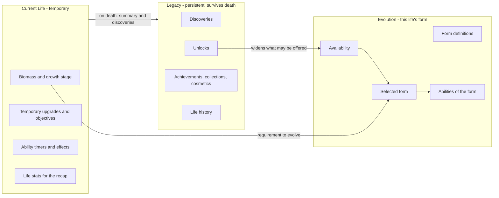
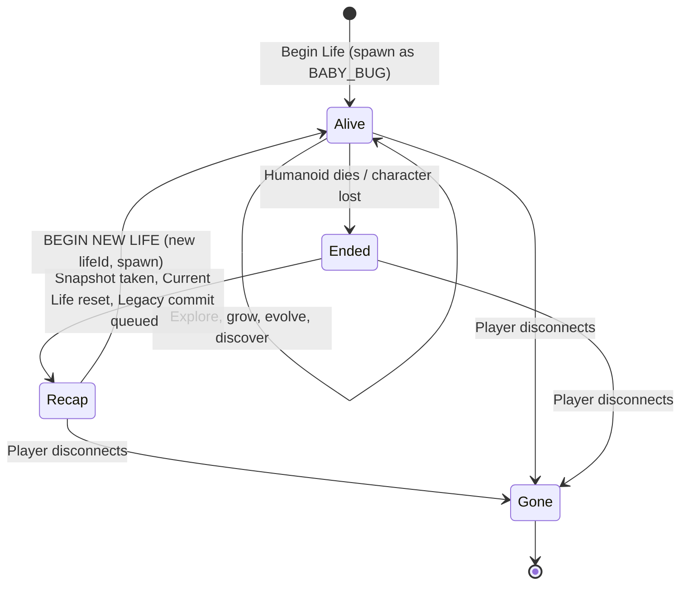
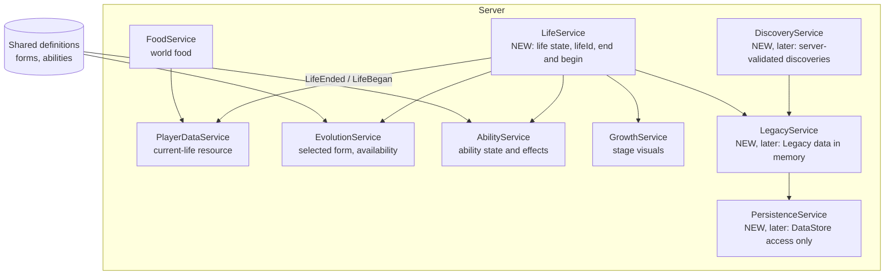

# TINY TITANS — Evolution Sandbox Architecture

**Status:** Technical reference. Describes current system boundaries and the intended Current Life / Evolution / Legacy architecture; verify implementation claims against current master and Studio.
**Branch:** `docs/define-evolution-sandbox`
**Product definition:** `Gameplay Blueprint & MVP Contract.md`. **Execution plan:** `Tiny Titans Master Roadmap.md`.
**design-gate update (documentation only):** adds the banner at the start of section 2, section 6.1, the status note and section 7.1, and the decision and question rows in section 12. The player-facing progression design is in `Combat Progression & Endgame Design v0.1.md`, section 13.
**Audited baseline:** the repository state after P1-05 lifecycle hardening (merged PR #26, based on master commit `5139da00` at the start of PR #27), including the earlier evolution-flow implementation (`Evolution.Select`, `EvolutionResult`, two-step selection UI). The P1 lifecycle implementation is present in code; automated test execution and Roblox Studio runtime validation are separate and must not be inferred from the merge.

## 0. Scope, sources and honesty notes

- This is an architecture and product-alignment document. It describes the current code accurately and proposes a path; it does not build anything.
- **Source documents and integration status.** The product source documents were consolidated into the Blueprint, Product Vision and Master Roadmap. This document is aligned with them where decisions are sufficiently defined; unresolved design choices remain explicitly provisional.

  | Source | Status reviewed | Architectural consequence |
  |---|---|---|
  | `docs/Gameplay Blueprint & MVP Contract.md` | Current product definition | Defines the game, first habitat, core loop, form roles and ability quality bar. |
  | `docs/Combat Progression & Endgame Design.md` | Deferred design reference | Contains candidate combat and endgame ideas. It is not approved implementation scope or a launch roster commitment. |
  | `docs/Product Vision & Top 1000 Strategy.md` | Product north star | Governs quality principles, Top 1000 ambition, player value, monetization guardrails and evidence discipline. |

  **Document authority:** Product Vision = why and quality bar; Gameplay Blueprint = what game and what abilities must accomplish; Master Roadmap = when and in what order; this document = technical boundaries. Combat Progression & Endgame is a deferred reference only. A proposal in this document does not mean it is implemented or validated.
- **Verification level:** everything in section 2 was read from the source files. Nothing in this document was tested in Roblox Studio by the author. The team's own Play Solo observations (spawn, walking, jumping, food, HUD at 40/100 and Stage 2/3, abrupt growth, intermittent ground clipping) are reported by the team, not re-verified here. The unit tests (section 2.8) have not been executed by the author either (the test runner was unavailable in the authoring environment).
- Items that cannot be established from code are labelled **Unknown** or **Needs Studio validation**.

## 1. Product model and terminology

The game is an **Evolution Adventure Sandbox**. A player lives a series of lives. Each life is temporary; what the player learns is permanent.

| Term | Meaning |
|---|---|
| **Life** | One continuous run from spawning as `BABY_BUG` until death. Identified by a `lifeId`. |
| **Current Life** | All temporary state that belongs to one life. Reset on death. |
| **Form** | The creature body and ability set in use right now. Today: `BABY_BUG`, `TANK`, `GLIDER`. |
| **Class** | An evolved playable form with its own role. The target roster is four classes (section 1.1). **Baby Bug is the starter form and tutorial identity, not a class.** |
| **Evolution** | The act of changing form during a life, and the system (definitions, requirements, selection) that governs it. |
| **Legacy** | Persistent, player-level knowledge that survives death and rejoining. Never raw power. |
| **Discovery** | A permanent record that something was found or seen (species, landmark, secret, form). |
| **Unlock** | A permanent change to which options can ever be offered in future lives (for example a new form). |
| **Biomass** | Proposed name for the current-life growth resource (today: `Energy`). See section 7. |
| **Life Recap** | The summary shown after death, before a new life begins. |

Three questions about an evolution option must never be confused:

1. **Discovered**: has the player ever seen/found it? (Legacy, informational.)
2. **Available**: may it be offered to the player in the current life, right now? (Computed from Legacy unlocks plus current-life conditions.)
3. **Selected**: which form is the player actually using in this life? (Current Life.)

A discovery never makes an option available by itself, and availability never bypasses the selection rules.

### 1.1 Form roster: current implementation versus first-release target

| | Current implementation | Target for initial launch (provisional) |
|---|---|---|
| Starter | `BABY_BUG` (form, tutorial identity) | Baby Bug (not a class) |
| Evolved forms | `TANK` (Shell, visual only) and `GLIDER` (Air Glide prototype) | Tank and Glider are the only planned evolved forms for the first vertical slice; their gameplay roles must pass the Blueprint's validation gate |
| Not implemented | n/a | **Striker / Hunter** and **Support / Controller** |

Notes:

- Do not treat a four-class roster as a launch requirement. Striker, Support and Controller remain unapproved future concepts with no implementation commitment.
- The deferred Combat Progression & Endgame document contains a broader 4–6-form exploration idea. It is not a product requirement. Add a form only when playtests prove a new gameplay verb is needed.
- Each class should eventually have distinct strengths, weaknesses, counterplay and a meaningful gameplay identity. Today Tank and Glider differ only by their ability, and the Tank shell has no combat effect because no combat system exists.
- Initial MVP planning is Baby Bug plus the two evolved prototypes, only if their distinct roles are validated. A smaller, excellent roster is preferred to a larger shallow one.

### 1.2 Product guardrails (direction; none of this is implemented)

These guardrails are grounded in the reviewed Evolution Adventure Sandbox Roadmap, Combat Progression & Endgame Design and Product Vision documents. They describe product direction; none of the future systems below is implemented today:

- Death ends the current life, resetting Current Life state while Legacy discoveries, achievements, collections and identity persist.
- Legacy and long-term progression grant choices, knowledge, identity and access—not permanent raw combat power or unchecked numerical advantages.
- PvE is a core activity. PvP is optional and fair; PvPvE remains an exploratory future mode and must not be forced on players.
- No paid resurrection, death protection, or monetized combat advantage.
- Combat outcomes, damage, healing, status effects, targets and rewards must be server-authoritative.
- Today: there is no damage, health, combat, PvE, PvP or PvPvE system, and no persistence or DataStore code.

## 2. Implementation inventory (what exists today)

> **Historical baseline (P2-01 note).** Sections 2.1 to 2.10 describe the code as audited for architecture audit, before several merged changes: the Energy to Biomass rename (PR #21), `LifeService` (PR #22), the reset on death (P1-03), controlled respawn with a recap (P1-04) and lifecycle hardening (P1-05). Rows that say `Energy`, "death changes nothing" or "respawn is automatic" are superseded. The current verified behavior is tabulated in `Combat Progression & Endgame Design v0.1.md`, section 13.2. Nothing here was re-validated in Studio.

### 2.1 Runtime structure

Rojo project (`default.project.json`) maps `src/Workspace`, `ReplicatedStorage/Shared`, `ServerScriptService` and `StarterPlayerScripts`. Server bootstrap order in `Bootstrap.server.lua`: `PlayerDataService`, `GrowthService`, `FoodService`, `EvolutionService`, `AbilityService` (all but the first receive the service they depend on through `Init(...)`). Client bootstrap starts `EnergyUIController`, `EvolutionUIController`, `AbilityController`.

Shared modules (pure, no Roblox services, unit-testable): `Config`, `Growth`, `Food`, `Evolution`, `Ability`.

### 2.2 State ownership

| State | Owner (server) | Shape | Notes |
|---|---|---|---|
| Energy | `PlayerDataService` | `energyByPlayer[Player]: number` | Clamped to `EvolutionEnergyRequired` (100). Only `AddEnergy` mutates it. |
| Growth stage | derived | `Growth.GetStageIndex(energy)` | Never stored; thresholds 0, 30, 60. |
| Selected form | `EvolutionService` | `formByPlayer[Player]: string` | Starts `BABY_BUG` (`Config.BaseForm`). Stored per Player, not per character. |
| Evolution availability | derived | `Evolution.IsAvailable(energy, ...)` | Recomputed on every energy change. |
| Evolution request rate limit | `EvolutionService` | `lastRequestAt[Player]` | Anti-spam, not gameplay. |
| Shell state | `AbilityService` | `states[Player]`: `activeUntil`, `readyAt`, `token`, shell Part, died connection | Timestamps are `workspace:GetServerTimeNow()`. |
| Glide state | `AbilityService` | `states[Player].glide`: `activeUntil`, `readyAt`, `token`, attachment, force, wings, connections | Same pattern as the shell. |
| Ability request rate limit | `AbilityService` | `lastRequestAt[Player]` | Anti-spam. |
| Body scale state | `GrowthService` | `scaleStates[Player]`: character, target, tweens | Presentation of the stage. |
| Food items | `FoodService` | one `{marker, part, active}` per `FoodSpawn` tag; `Workspace.Food` folder | World state, shared by all players. |

### 2.3 Replicated Player attributes

All Player attributes replicate to every client, including other players. Clients only read them; writes from a client do not reach the server.

| Attribute | Written by | Read by (client) | Meaning |
|---|---|---|---|
| `Energy` | `PlayerDataService` | `EnergyUIController` | Current-life resource |
| `GrowthStage` | `PlayerDataService` | `EnergyUIController` | Derived stage |
| `EvolutionForm` | `EvolutionService` | `EvolutionUIController`, `AbilityController` (and the overhead tags) | Selected form |
| `EvolutionAvailable` | `EvolutionService` | `EvolutionUIController` | Evolution may be chosen now |
| `ShellActiveUntil`, `ShellReadyAt` | `AbilityService` | `AbilityController` | Server-time timestamps |
| `GliderActiveUntil`, `GliderReadyAt` | `AbilityService` | `AbilityController` | Server-time timestamps |

### 2.4 Remotes

| Remote | Direction | Payload | Server handling |
|---|---|---|---|
| `Remotes.RequestEvolution` | client to server | branch name string | Rate limit, alive check, `Evolution.Select`, then reply |
| `Remotes.EvolutionResult` | server to client (requester only) | reason string | Explains a rejection or confirms; UI state itself follows attributes |
| `Remotes.RequestAbility` | client to server | ability id string (`"SHELL"` or `"GLIDE"`) | Rate limit, id check, form check, character/state validation |

There are no RemoteFunctions. Food collection has no client request (server-side proximity). All remotes are created at runtime by the server under `ReplicatedStorage.Remotes`.

### 2.5 Server-created runtime instances

`Workspace.Food` (folder) and its food balls; `DefensiveShell` part (inside the character); `GlideWing` parts, `GlideAttachment` and `GlideForce` (VectorForce) on the character. Each is removed by its owning service when its effect ends.

### 2.6 What survives what (current behavior)

| State | Respawn / death (same session) | Leave and rejoin |
|---|---|---|
| Energy, growth stage | **Kept** | Lost (session only) |
| Selected form | **Kept** | Lost |
| Ability cooldowns (`*ReadyAt`) | **Kept** | Lost |
| Active ability effects (shell, wings, force) | **Cleared** (`Humanoid.Died` and `CharacterRemoving`) | Cleared |
| Body scale | New character is set to the current stage's scale | Lost |
| Food in the world | Unaffected | Unaffected |
| Client HUD | Persists (`ResetOnSpawn = false`) | Rebuilt |
| Rate-limit timestamps | Kept | Lost |

**Death is not modelled.** No code distinguishes death from a respawn, nothing resets progression, and nothing in the project changes `Players.CharacterAutoLoads` or `RespawnTime` (so Roblox defaults apply; place-level settings are **Unknown**). Without a damage/hazard system the only practical ways to die today are the Roblox reset and falling out of the world.

### 2.7 Authority

- **Server-authoritative:** energy and cap, growth stage, food collection, evolution eligibility and selection, ability eligibility, activation, timing and cooldowns, the creation and removal of all effect instances, the per-player rate limits.
- **Client-owned (trust boundary):** input, all UI state (card highlight, pending flag, toast), and the player's own character physics (the client is the network owner). The server can decide when a glide starts and ends but cannot stop a modified client from ignoring the glide force; no movement validation exists.
- **Presentation only:** HUD, form badge, toast, overhead form tags, body-scale tweens, shell and wing visuals.

### 2.8 Test coverage

Four Lune-run test files cover the pure shared modules only: `Growth` (40 checks), `Multiplayer` (40; food selection, energy accounting and cross-player isolation using the pure rules), `Evolution` including `Select` (50), `Ability` including glide rules and rate limiting (64). The services, UI controllers, remotes, character lifecycle, physics and multiplayer behavior have **no automated coverage**. Test execution status: the author did not run them (runner unavailable); whether the team has run them is **Unknown**. Lune is not in `rokit.toml`.

### 2.9 Needs Roblox Studio runtime validation

Evolution UI layout and confirm flow; glide feel, landing detection and wing visuals; shell look; growth tween smoothness; the intermittent ground-clipping cause (candidates are listed in the README); `FloorMaterial`/`StateChanged` replication from a client-owned character; multi-client behavior; default respawn timing; touch controls.

### 2.10 Differences between today and the new direction

| # | Today | New direction |
|---|---|---|
| 1 | Death changes nothing; progress survives it | Death ends the life and resets Current Life |
| 2 | Form is never reset | Form resets to `BABY_BUG` each life |
| 3 | Ability cooldowns persist across death | Temporary ability state is cleared at life end |
| 4 | Biomass (then called Energy) caps at 100 and equals the evolution threshold; after evolving there is no further progression. **Still true in code** | Growth resource drives a longer adventure (PROPOSED model in section 7.1) |
| 5 | Forms and abilities are hardcoded in `Config`, `AbilityService` branches and `FORM_INFO` in the UI | Definition-driven forms and abilities |
| 6 | No persistence (explicit non-goal of the v0.1 Technical Design) | Legacy persists across lives and sessions |
| 7 | One arena, no discovery concept | Habitat with discoverable species, territories, secrets |
| 8 | No damage, health or hazard systems; Tank shell is visual only | Needed for real death causes and a meaningful Tank; PvE is a core direction, PvP optional and fair |
| 8a | Two evolved classes implemented (Tank, Glider) | Four evolved classes (adds Striker / Hunter and Support / Controller, provisional) |
| 9 | Respawn is Roblox's automatic one | Controlled respawn with a Life Recap and "Begin New Life" |
| 10 | All progression attributes are visible to all clients | Legacy and recap data must be private to the owner |
| 11 | Single resource, no temporary upgrades or objectives | Current Life includes temporary upgrades and objectives |

## 3. The three layers



Responsibilities:

- **Current Life** owns everything that must be wiped when the player dies. It is the only layer that is reset.
- **Evolution** owns the definitions of forms and abilities and the rules for offering and selecting a form. Definitions are static data; the *selected* form is Current Life state.
- **Legacy** owns permanent knowledge. It may expand what can be offered and what the player knows, but it **must not grant permanent power**: no permanent damage, health, speed or resource multipliers, no teleportation or traversal bypass for a discovered place.

### 3.1 Classification of every existing state field

| Field | Layer | At life end | Rationale |
|---|---|---|---|
| `Energy` (to become Biomass) | Current Life | Reset to 0 | Core growth resource |
| `GrowthStage` | Current Life (derived) | Recomputed (stage 1) | Never stored |
| `EvolutionAvailable` | Current Life (derived) | Recomputed (false) | Depends on resource and form |
| `EvolutionForm` | Evolution (selected form) | Reset to `BABY_BUG` | Selection belongs to one life |
| Shell and glide `*ActiveUntil` | Current Life | Cleared immediately | Must not leak into the next life |
| Shell and glide `*ReadyAt` (cooldowns) | Current Life | **Proposed: reset** | See below |
| `DefensiveShell`, `GlideWing`, `GlideForce`, `GlideAttachment` | Current Life (temporary instances) | Destroyed | Already destroyed on death/removal today |
| Body scale and `scaleStates` | Current Life (presentation) | Next character spawns at stage 1 scale | Tied to the stage |
| `formByPlayer`, `energyByPlayer`, `states`, `scaleStates` | Server runtime tables | Entries reset, not deleted, while the player is connected | Deleted only on `PlayerRemoving` |
| Ability and evolution rate-limit timestamps | Session (connection-scoped) | **Kept** | Anti-spam must not be bypassed by dying |
| Client UI state (`selected`, `pending`, toast, tags) | Client presentation | Cleared when the server state changes | Derived from attributes |
| Food items in `Workspace.Food` | World | Untouched | Not per player |
| `Config` values | Static data | n/a | n/a |

**Cooldowns, explicitly.** Today they persist across death. Proposal: reset them with the life, so a new life starts from a clean, predictable state and the cooldown rules do not become hidden cross-life state. Risk: if dying were ever cheap and combat exists, dying could be abused to refresh a cooldown. Mitigation: the Life Recap and controlled respawn add a delay, and cooldowns are short. This is open question Q3.

New fields the model needs (not present today): `lifeId`, `lifeStartedAt`, highest form reached this life, life stats (food eaten, distance, discoveries made this life), temporary upgrades, objective progress.

## 4. Death and rebirth lifecycle



`Begin Life → Explore → Grow → Evolve → Discover → Death → Life Recap → Reset Current Life → Begin New Life`

**Responsible component.** A new `LifeService` (server) owns the life state machine and `lifeId` per player. It is the only code that decides a life has ended. It detects the end from `Humanoid.Died` and, as a fallback, from a character being removed while the life is `Alive` (for example a reset or a lost character). It follows the existing pattern: a server-only BindableEvent (like `PlayerDataService.ProgressChanged`) that other services subscribe to. No framework.

**Sequence at life end** (synchronous parts first, so no gameplay state is ever active between lives):

1. `LifeService` marks the life `Ended` (idempotent: a second Died or removal signal is ignored).
2. Each owning service clears temporary effects at once through its subscription: `AbilityService` ends shell/glide and clears timers; `GrowthService` cancels tweens.
3. `LifeService` takes a **snapshot** for the recap (duration, highest form, discoveries made this life) from state that has not been reset yet.
4. The Current Life state is reset by its owners: `PlayerDataService` resets Biomass; `EvolutionService` resets the form to `BABY_BUG` and recomputes availability; `AbilityService` resets cooldowns. Resetting immediately (rather than at "Begin") means attributes already describe the next life while the recap is showing, and nothing stale can act on the next life.
5. Legacy changes from this life are queued for commit (section 8); this step never blocks the player.
6. The player sees the recap (future UI) and presses **BEGIN NEW LIFE** (a request with no payload; the server checks the life is `Ended`).
7. `LifeService` increments `lifeId`, marks `Alive`, and spawns the character. Controlled respawn means `Players.CharacterAutoLoads = false` and `Player:LoadCharacter()` from `LifeService`. **Needs Studio validation** (first-join spawn, Studio Play Solo, reset button behavior, load order with `GrowthService`).

**Preventing stale effects.** Every delayed callback and event handler that can outlive a life captures the `lifeId` (in addition to the existing per-effect `token`) and does nothing if the player's current `lifeId` differs or the life is not `Alive`. Ending a life also bumps every effect token, which the existing `endShell`/`endGlide` already do.

**Character replacement.** Existing handling stays: `CharacterRemoving` ends effects, `GrowthService` re-applies scale to each new character, HUD uses `ResetOnSpawn = false`. A character replaced during an `Alive` life without dying (it should not happen with controlled respawn) is treated as a life end.

**Disconnect during death or the transition.** `PlayerRemoving` ends the life if it is not already ended (idempotent), takes the snapshot, queues the Legacy commit, then flushes the save queue (section 8) and deletes the player's runtime state. Discoveries are committed when they happen, not only at death, so a disconnect cannot lose them. The recap itself is not persisted in v1; an unseen recap may be lost.

**Recap content (future).** Life duration, highest form reached, areas discovered, species discovered, new Legacy unlocks, and the `BEGIN NEW LIFE` action. No recap UI is built by this milestone.

## 5. Proposed service boundaries



Rules: only `LifeService` ends and begins lives; each service resets only its own state; `LegacyService` is the only owner of Legacy data in memory; `PersistenceService` is the only code that touches `DataStoreService`; no service reads another's private tables (they use exported functions or the server-only events, as `EvolutionService` already uses `PlayerDataService.GetEnergy`).

## 6. Configurable evolution model

**Goal.** Add forms by adding data, not by editing `if` branches in several files. Keep the scope small: three forms today (the starter and two classes), and a target of the starter plus four classes. The model is not meant to open a larger roster.

**Conceptual data contract** (illustration only; not implemented here; the v0.1 Technical Design already anticipated a `CreatureDefinitions.lua`):

```lua
-- Shared/CreatureDefinitions.lua (conceptual; only forms that exist today are shown.
-- Striker / Hunter and Support / Controller have no definition because they are not designed yet.)
Forms = {
    BABY_BUG = { id = "BABY_BUG", displayName = "Baby Bug", role = "Starter", isStarter = true },
    TANK = {
        id = "TANK",
        displayName = "Tank",
        role = "Defensive",
        description = "Heavy and defensive.",
        unlock = { kind = "Always" },            -- or { kind = "Legacy", id = "FORM_TANK" }
        requirement = { resource = "Biomass", amount = 100 }, -- to select it within a life
        abilities = { "SHELL" },
        visual = { tagColor = Color3.fromRGB(70, 110, 160) }, -- model/asset refs later
    },
    GLIDER = { id = "GLIDER", --[[ same shape ]] abilities = { "GLIDE" } },
}
Abilities = {
    SHELL = { id = "SHELL", form = "TANK", handler = "Shell", key = "Q", duration = 3, cooldown = 12 },
    GLIDE = { id = "GLIDE", form = "GLIDER", handler = "Glide", key = "Q", duration = 3, cooldown = 10,
              params = { gravityCompensation = 0.9, ascentCompensation = 0.65 } },
}
```

| Field | Purpose |
|---|---|
| `id` | Stable identifier, never changed once shipped (it will appear in Legacy data) |
| `displayName`, `role`, `description` | UI text, so UI is generated from data |
| `unlock` | Permanent availability condition (Legacy-driven); `Always` for the first two forms |
| `requirement` | What the current life must have to select it (today: 100 energy) |
| `abilities` | Ability ids; the ability definition names its form and handler |
| `visual` | Visual identity references (tag color now; model ids later) |
| ability `params` | Tuning values currently in `Config` |

**Three states per form** (section 1): `discovered` (Legacy set), `available` (computed: `unlock` satisfied by Legacy and the life's conditions), `selected` (one value, Current Life).

**Migration of Tank and Glider (keep the useful code).** The tested behavior stays; only where it is configured changes.

| Existing | Becomes |
|---|---|
| `Config.TankShell*`, `Config.Glider*`, `AbilityShellId`, `AbilityGlideId`, `GliderForm`, `TankShellForm` | Ability definitions (`SHELL`, `GLIDE`) and form ids. `Config` keeps global tuning and anti-spam values |
| `AbilityService.activateShell` and `activateGlide` | Unchanged handlers registered under `handler = "Shell"` / `"Glide"`. `onRequestAbility` looks the id up in definitions and calls the handler instead of an `if/elseif` |
| `Ability.Validate` / `ValidateGlide` | Kept; the required form and timings come from the ability definition |
| `Evolution.Select`, `Validate`, `IsValidForm`, `IsAvailable` | Kept; `forms` and the threshold come from the player's *available* forms and their requirements |
| `EvolutionUIController.FORM_INFO` and `RESULT_MESSAGES` | Cards generated from definitions; messages stay a small UI table |
| `Config.EvolutionForms`, `BaseForm` | Superseded by definitions; kept alongside during the migration, then removed |

**What stays shared across forms:** request validation, rate limiting, per-player state tables, server-time timestamps and replicated attributes, token/lifeId invalidation, cleanup on death/removal, UI card layout and the confirm flow. **What is form-specific:** the ability handler (effect and physics), its parameters, the form's visual identity, its requirement and unlock.

**Not proposed:** a generic ability framework, a dependency-injection container, scripting of abilities from data, or multiple-ability-per-form UI. Add only what the next form needs.

**Replicated attribute names** (`EvolutionForm`, per-ability timestamp pairs) stay compatible; if abilities become data-driven, timestamp attributes can later be keyed by ability id (a decision for P2, Q8).

### 6.1 Alignment with the P2-01 design gate (PROPOSED)

P2-01 is a documentation-only gate. It fixes what the engineering tasks must build; it builds nothing. Statuses are PROPOSED unless stated.

| Design decision (Combat doc, section 13) | Technical consequence | Task |
|---|---|---|
| Forms and their requirements are data, not branches | `CreatureDefinitions` with id, display text, role, requirement, abilities, unlock (`Always` for the first release) and visual references; `Evolution` takes forms and requirements from it. Behavior and remotes unchanged | P2-02 |
| Abilities are data with existing handlers | Ability definitions (id, form, duration, cooldown, parameters, handler name) read by `AbilityService`; `activateShell` and `activateGlide` stay | P2-03 |
| The selection UI shows what the definitions say | Cards generated from the available forms; honest descriptions come from data | P2-04 |
| Growth milestones are independent of the evolution requirement | Milestones and requirements are separate data. P2-02 may only move them into data, with **today's values unchanged** | P2-02 (data), P2-09 (values) |
| Biomass keeps accumulating after evolution, with a ceiling at the final milestone (REQUIRES PLAYTEST, needs approval) | A behavior change: the cap currently equals `EvolutionBiomassRequired` (see 7.1). Touches `PlayerDataService.CanGainBiomass`, `Growth.AddBiomass`, the food eligibility check in `FoodService` and the HUD ratio | P2-09, only after approval |
| Tank must gain a real world interaction | May depend on hazards or threats (P3, P4); P2-08 either defines one that needs no combat or records the dependency | P2-08 |
| Form mastery, discoveries, Legacy | Not P2 | P5 |
| No new forms, no persistence, no monetization | OUT OF SCOPE for all of P2 | n/a |

## 7. Energy versus Biomass

> **Status (P2-01 note):** option B below was **implemented** in PR #21 (the Biomass rename). The analysis is kept as the decision record, and its identifiers (`Energy`, `AddEnergy`, `EvolutionEnergyRequired`) are the pre-rename names. In the current code the names are `Biomass`, `AddBiomass`, `EvolutionBiomassRequired`, `FoodBiomass`. The statement that the cap equals the evolution requirement is **still true in code**.

Today: `Energy` is one number (0 to 100) that is both the growth resource and the evolution gate; `GrowthStage` is derived from it; the cap equals the evolution threshold, so after evolving there is nothing left to earn.

**Consumers of Energy:** `PlayerDataService` (`AddEnergy`, `GetEnergy`, `CanGainEnergy`), `FoodService` (`FoodEnergy`, cap check), `EvolutionService` (availability, validation), `GrowthService` (stage via `PlayerDataService`), `EnergyUIController` (HUD text `Energy N / 100`), `Config` (`EvolutionEnergyRequired`, `FoodEnergy`), the attribute `Energy`, shared helpers (`Growth.AddEnergy`, `ClampEnergy`, `GetStageIndex`, `GetProgressRatio`), and all four test files.

| Option | Pros | Cons |
|---|---|---|
| A. Keep Energy, add Biomass later | No churn now | Two overlapping resources invite confusion; "Energy" will read as stamina or ability fuel in a game where abilities have cooldowns; the rename gets more expensive once more code and Legacy data reference it |
| B. Rename Energy to Biomass (same quantity) | One clear Current Life resource named for what the player does (eat and grow); cheap now because nothing persists and every consumer is in this repository | Mechanical change touching many files and tests |
| C. Separate resource quantity from growth stage | Already true: stage is derived from the quantity | Nothing to build |
| D. Two resources (Biomass plus a separate Energy) | Allows ability fuel later | Speculative; adds systems nobody has asked for |

**Recommendation: B, combined with C (already true), and not D.** Rename the concept and the identifiers to Biomass in one mechanical, behavior-neutral change early in P1, before new lifecycle code is written, so the reset logic and the Legacy schema use the final name. Keep `GrowthStage` as a derived value. Decouple two ideas that are currently one constant: the **evolution requirement** (`EvolutionBiomassRequired`, now part of a form's `requirement`) and the **resource cap**; what happens at the cap (continue growing, or stop) is Q5. Do not introduce a second resource until a design needs one.

Impact if adopted: attribute `Energy` becomes `Biomass` (all readers are in this repository and ship together, no persisted data exists, so no dual-write is needed); HUD text changes; `FoodEnergy` becomes `FoodBiomass`; test names and expectations are renamed, values unchanged (cap 100, food 10, stages 0/30/60); no gameplay change. Biomass is Current Life state and is never stored in Legacy. If the team prefers to keep the word Energy for players, option A with a UI-only label is acceptable; the architecture does not depend on the word.

### 7.1 Resource model recommended by the P2-01 gate (PROPOSED, REQUIRES PLAYTEST)

The design reasoning is in `Combat Progression & Endgame Design v0.1.md`, section 13.5; only the technical shape is recorded here.

- **Three separate systems:** Biomass (a server-owned quantity), growth (a stage derived from Biomass, today `Config.GrowthStages` with `MinBiomass` and `Scale`), and evolution (an explicit selection once a requirement is met). They stay separate in code and in data.
- **Two constants are currently one:** `EvolutionBiomassRequired` is both the evolution requirement and the Biomass cap. The recommendation separates them: the requirement belongs to each form's definition (P2-02), and a per-life **ceiling** equal to the final growth milestone is a distinct value (its name is a P2-09 decision).
- **No spending:** Biomass is not consumed by abilities or purchases in the first release, so no second resource or ledger is needed.
- **Server authority is unchanged:** every Biomass source stays server-validated; a rare-resource or discovery source (FUTURE) must follow the `FoodService` pattern.
- **Nothing here changes today's values.** Cap 100, food 10, stages 0/30/60 stay until P2-09 and an approved playtest.

## 8. Persistence architecture (future; nothing here is implemented)

**Boundaries.** `PersistenceService` is the only module that calls `DataStoreService`. It exposes asynchronous load and save functions and reports success or failure explicitly. `LegacyService` holds a player's Legacy table in memory and decides *what* changes; it never touches DataStores. Gameplay services and clients never see the DataStore.

**Schema (versioned, conceptual):**

```lua
Legacy = {
    schemaVersion = 1,
    discoveries = { species = {id = true}, landmarks = {id = true}, secrets = {id = true}, forms = {id = true} },
    unlocks = { forms = {id = true} },              -- permanent availability only
    achievements = {id = true}, collections = {id = true}, cosmetics = {id = true},
    history = { {lifeId, startedAt, durationSeconds, highestForm, ...}, ... }, -- bounded list
    stats = { livesLived = n, ... },
}
```

No Biomass, no multipliers, no power values. Keys use stable string ids. One key per player (`UserId`), one DataStore for Legacy.

**Merge-friendly data.** Sets (discoveries, unlocks, achievements) merge by union and history entries are deduplicated by `lifeId`, so two overlapping saves can never delete a discovery. Counters are derived from history or incremented idempotently per `lifeId`.

**Load.** On `PlayerAdded`, load with a bounded retry (exponential backoff with a total time budget). Until loaded, the player may play in "Legacy unavailable" mode. If loading ultimately fails, Legacy stays in memory only, the player is told Legacy could not be loaded, and loading is retried in the background.

**Save.** Changes are marked dirty and coalesced; at most one save per player is in flight; saves use `UpdateAsync` with the merge function above (so it always merges with the latest stored data, never blindly overwriting). A change counts as committed **only when the call returns success**; failed saves stay queued and retry with backoff. Save triggers: when a discovery or unlock is recorded (debounced), at life end, periodically (autosave interval), on `PlayerRemoving`, and on `game:BindToClose` (bounded, parallel).

**Overlapping servers** (rejoin while the old server is still saving): union/idempotent merges make this safe without a session lock; a lock can be added later if a non-mergeable field is introduced.

**Persistence unavailable.** If the data store is unreachable or API access is disabled (for example Studio without API services enabled), the game keeps working from memory, does not claim anything was saved, and queues commits. If data later loads, session discoveries are merged into it by union, never overwritten.

**Migration.** Each saved record carries `schemaVersion`; load runs ordered, tested pure migration functions up to the current version. Old fields are never silently dropped.

**Exploit resistance.** The client never sends Legacy data. Discoveries are recorded only by server code that validates the event (for example the player's server-side position inside a landmark zone, or a server-owned encounter). Legacy is private: sent only to its owner through a dedicated remote, not through attributes (which replicate to everyone). Request volume must respect Roblox DataStore request budgets (verify current limits in the official documentation; **Unknown** here).

**Normal death/rebirth never loses discoveries**, because they are committed as they happen, the life-end commit is queued before the recap, and the save queue is flushed on disconnect and shutdown.

## 9. RemoteEvent and server-authority principles

Existing and retained: the server derives the player from `OnServerEvent`; clients send only identifiers (a branch name, an ability id), never energy, forms, timestamps or targets; every request passes a per-player rate limit first, then argument validation, then state validation; rejections change nothing; UI state follows replicated attributes; replies go only to the requester.

Additions proposed:

- At most two new remotes in the lifecycle work: `RequestBeginNewLife` (client to server, no payload, valid only when the life is `Ended`) and `LifeRecap` (server to the owner only, one summary). Legacy delivery to its owner uses another owner-only server-to-client remote when Legacy UI exists (not before).
- Anything private (Legacy, recap, future inventory) is sent with `FireClient` to its owner, never as a Player attribute.
- Any new request is rate limited the same way as the existing ones and is idempotent.
- No generic networking framework; remotes remain created by the server in `ReplicatedStorage.Remotes`.
- Known limitation carried forward: the client owns character physics; discoveries and any future damage must not rely on client-reported positions.

## 10. Compatibility assessment of the merged evolution-flow work (PR #17)

| Part | Assessment | Notes |
|---|---|---|
| `Evolution.Select`, `Validate`, `IsAvailable`, `IsValidForm` | **Keep, adapt later (P2)** | Semantics are right (a rejection returns the unchanged form). Later: take forms and thresholds from definitions and the player's available forms. |
| `EvolutionService` per-Player form table, rate limit, alive check, `refresh`, attributes | **Keep, adapt later (P1/P2)** | Add: reset to `BABY_BUG` on life end, `lifeId` guard, availability from definitions. |
| `Remotes.RequestEvolution` and `Remotes.EvolutionResult` | **Keep as-is** | Contract (branch name in, reason out to requester) fits the new model. |
| Attributes `EvolutionForm`, `EvolutionAvailable` | **Keep as-is** | `EvolutionForm` means "form selected in the current life". |
| Two-step selection UI, toast, pending/timeout, responsive panel | **Keep, adapt later (P2)** | Cards should be generated from definitions and from the available-forms list. |
| `FORM_INFO` and hardcoded descriptions in the UI | **Replace later (P2)** | Move into form definitions. |
| `Config.EvolutionForms`, `BaseForm`, `TankShellForm`, `GliderForm` and per-ability constants | **Replace later (P2)** | Keep during migration for compatibility. |
| `AbilityService` shell/glide handlers, tokens, cleanup | **Keep as-is** (handlers); **adapt later** (dispatch by id) | Reuse the existing, reviewed code as handlers. |
| Biomass cap equal to the evolution requirement | **Keep for now; revisit in P2-09** (PROPOSED change) | See sections 7.1 and 12 (Q5). |
| Session-only form ("rejoin resets") | **Keep, extended**: death now also resets | Legacy persistence does not persist the selected form. |
| Existing tests | **Keep and extend** | Rename with Biomass; add life-cycle tests. |
| Nothing is recommended for removal | n/a | No second evolution-selection implementation should be created. |

## 11. Failure cases and edge cases

| Case | Expected behavior |
|---|---|
| Two death signals (Died plus character removal) | `LifeService` ends the life once; later signals are ignored |
| Death during an active shell or glide | Effects end immediately; timers are invalidated by token and `lifeId` |
| Death while the evolution panel is open or a request is pending | State resets; a late `RequestEvolution` fails the alive/state checks; UI follows attributes |
| Evolution request arrives after death | Rejected (not alive, life not `Alive`) |
| `BEGIN NEW LIFE` spammed or sent while `Alive` | Ignored; only valid in `Ended`; rate limited |
| Player leaves during recap or transition | Life ends if not yet ended; Legacy queue is flushed; runtime state deleted; delayed callbacks check the player is still connected |
| Character replaced without dying | Treated as life end (should not happen with controlled respawn) |
| Respawn never completes (`LoadCharacter` failure) | Retry with a bounded count, then report an error; the life stays `Ended` |
| Stale tween, timer or heartbeat from an old life | Guarded by `lifeId` and tokens; services clear their own handles at life end |
| Save fails or the store is unavailable | Discoveries stay in memory and queued; retried; never reported as saved |
| Rejoin while the old server still saves | Union/idempotent merges make the result consistent |
| Client claims a discovery | No such remote exists; discoveries come only from server-validated events |
| A client changes its own attributes | Not replicated; the server never reads attributes for decisions |
| Studio Play Solo / API access disabled | Persistence layer runs in "unavailable" mode with a visible note |
| Cooldown reset by dying (future combat) | Mitigated by recap and respawn delay; Q3 |
| Server shutdown | `BindToClose` flushes saves within a bounded time |

## 12. Open questions and explicit decisions

Decisions this document proposes (need owner approval):

| ID | Decision | Proposed default |
|---|---|---|
| D1 | Death resets Current Life (Biomass, form, temporary state, cooldowns) immediately after the snapshot | Yes |
| D2 | A new `LifeService` owns the life state machine; other services subscribe to its events | Yes |
| D3 | Controlled respawn via `CharacterAutoLoads = false` and `LoadCharacter` | Yes, pending Studio validation |
| D4 | Rename Energy to Biomass before building lifecycle code | Yes (Q1) |
| D5 | Definition-driven forms and abilities; keep Tank/Glider handlers | Yes |
| D6 | Legacy never grants raw power; discoveries do not bypass traversal | Yes |
| D7 | Legacy persistence via `UpdateAsync` with mergeable data and no session lock in v1 | Yes |
| D8 | Initial launch roster is the Baby Bug starter plus exactly four evolved classes; no fifth or sixth class before validation | Yes (from the brief) |
| D9 | P2-01 is a documentation-only design gate; creature-definition engineering is P2-02 | APPROVED DESIGN (from the P2-01 brief) |
| D10 | Biomass keeps accumulating after evolution with a ceiling at the final growth milestone; growth milestones independent of the evolution requirement | PROPOSED; REQUIRES PLAYTEST; engineering in P2-09 after approval |

Open questions:

| ID | Question | Why it matters |
|---|---|---|
| Q1 | Is "Biomass" the final player-facing name, or only an internal name? | Rename scope |
| Q2 | Is the Roblox reset button a death (it sets health to 0)? | Abuse and recap spam |
| Q3 | Do ability cooldowns reset on a new life? | Section 3.1 |
| Q4 | Should there be a minimum life length before history/recap counts? | History noise |
| Q5 | What happens at the Biomass cap: stop, keep growing past 100, or multi-stage evolution lines? **P2-01 recommendation (PROPOSED, needs approval and playtest):** keep growing in the chosen form up to a ceiling at the final growth milestone; no multi-stage evolution tree in the first release (Combat doc, sections 13.3 and 13.5) | Longer adventure; evolution threshold |
| Q6 | Which discoveries exist in the first habitat (species, landmarks, secrets) and what triggers them? | P3/P5 scope |
| Q7 | Does the recap time out and auto-begin a new life, or wait for the button? | Idle players |
| Q8 | Ability timestamp attributes: keep per-ability names or key by ability id? | Replication naming |
| Q9 | May other players see anyone's Biomass, or only form? | Privacy; attributes vs remotes |
| Q10 | What are Roblox place settings for respawn (`RespawnTime`, `CharacterAutoLoads`)? | Currently **Unknown** |
| Q11 | What is the cause of the intermittent ground clipping? | Unresolved; needs the Studio procedure in the README |
| Q12 | What is the exact deferred combat-design gate combat prototype scope and its exit gate before P4 production implementation? | Combat foundation, Studio validation and scope control |
| Q13 | What signature mechanics and counterplay define Striker / Hunter and the proposed combined Support / Controller role? | Class identity; the combined role must be validated against the separate Support and Controller candidate directions in the combat design |
| Q14 | Which optional PvP format, if any, is justified after the PvE core is validated, and what PvPvE experiment is worth testing? | Fairness, anti-farming and multiplayer scope |

The source documents are present and reviewed; this appendix is intentionally omitted rather than retaining obsolete instructions to update a supposedly unavailable Product Vision document.
