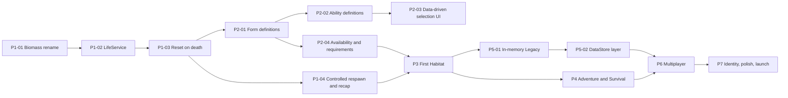

# TT-P0-02R — Implementation Migration Plan

**Status:** Proposal for review. Documentation only. **P1 to P7 is a proposed implementation sequence, not an immutable product roadmap**: the roadmap (PR #18) and combat design (PR #19) could not be verified when this was written, so this plan is not claimed to be integrated with them and must be reconciled once they are available. Approving this document is **not** runtime validation of anything.
**Companion:** `Evolution Sandbox Architecture v0.1.md` (section numbers below refer to it).
**Principle:** small, reviewable steps that keep the game playable after every merge. No big-bang rewrite. Working systems are adapted, not replaced.

## What exists today versus what this plan adds

Already implemented and **not** part of this plan (code as of the audited baseline): arena and spawn; food collection and 0/30/60/100 progression; smooth growth; Energy HUD; evolution selection (two-step UI, `EvolutionResult`); Tank Defensive Shell (visual only); Glider Air Glide; session-only per-player state; per-player rate limits. Forms in the prototype: `BABY_BUG`, `TANK`, `GLIDER`.

Not implemented (everything below is future work): lives, death reset and recap; Biomass rename; definition-driven forms and abilities; habitat and discoveries; health, damage, PvE; the Striker / Hunter and Support / Controller classes; Legacy and any DataStore code; PvP and PvPvE.

**Target roster (provisional):** the Baby Bug starter (not a class) plus exactly four evolved classes: Tank / Guardian, Glider / Skirmisher, Striker / Hunter, Support / Controller. Two exist; two do not. No fifth or sixth class is in initial scope.

## How to read this plan

- Steps are numbered `P<phase>-<nn>`. Each step is intended to be one focused PR.
- **Studio** says whether Roblox Studio runtime validation is required before the step is accepted. Automated tests only cover the pure shared modules (Lune); services, UI, remotes and character lifecycle need Studio.
- "Existing files" lists what the step reads or changes; "New files" lists what it adds. Test names refer to the existing Lune convention (`tests/<Name>.test.lua`).
- The roadmap document that defines P1 to P7 was not available when this plan was written. The phase names follow the task brief; scope inside P3 to P7 is deliberately coarser than P1 and P2 and must be refined when those phases start.

## Sequence changes from the brief (and why)

1. **Energy to Biomass rename is the first step of P1**, before lifecycle code, so the reset logic, tests and later Legacy schema use the final name once (architecture section 7).
2. **A damage/health step is placed in P4**, but P1 does not depend on it: lifecycle work is verified with the Roblox reset (Humanoid health set to 0). Natural death causes arrive in P4.
3. **Controlled respawn comes after the reset logic** (P1-03 before P1-04): resetting state on death is testable with default respawn; changing `CharacterAutoLoads` is the riskiest part and is isolated in its own step.
4. **Persistence (P5) is split** into an in-memory Legacy model first and the DataStore layer second, so discovery gameplay can be built and tested before any DataStore code exists.

Everything else follows the brief's order.

## Dependency overview

---

## P1 — Core Life Cycle

Goal of the phase: a life can end and a new one begins from a clean `BABY_BUG` state, with no stale effects, using the existing arena.

### P1-01 — Rename Energy to Biomass (behavior-neutral)

- **Goal:** one Current Life resource named Biomass; no gameplay change. (Skip or reduce to a UI-only label if the owner chooses to keep "Energy"; decision Q1.)
- **Existing files:** `Config.lua`, `Growth.lua`, `PlayerDataService.lua`, `FoodService.lua`, `EvolutionService.lua`, `GrowthService.lua`, `EnergyUIController.lua`, all four tests, README.
- **New files:** none. `EnergyUIController` may be renamed (for example `BiomassUIController`) together with its bootstrap line.
- **Dependencies:** none.
- **Acceptance:** attribute `Biomass` replaces `Energy`; `FoodBiomass`, `EvolutionBiomassRequired` replace the Energy constants; values unchanged (cap 100, food 10, stages 0/30/60); HUD text updated; no references to the old names remain except in release notes.
- **Tests:** all existing tests pass after renaming; no new logic.
- **Studio:** yes (HUD, food, growth, evolution readiness; smoke test).

### P1-02 — `LifeService`: life state and death detection (no reset yet)

- **Goal:** one authoritative place that knows a player's life state (`Alive`, `Ended`) and `lifeId`, and announces life end and begin.
- **Existing files:** `Bootstrap.server.lua` (wire the service). Reads `Humanoid.Died` and `CharacterRemoving`.
- **New files:** `Services/LifeService.lua`; `Shared/Life.lua` (pure transition rules: valid transitions, idempotent end, `lifeId` increment); `tests/Life.test.lua`.
- **Dependencies:** P1-01 recommended.
- **Acceptance:** exactly one `LifeEnded` per life even with duplicate signals; `lifeId` increments only on a new life; a `LifeState` attribute (or server-only state) reflects `Alive/Ended`; no gameplay change yet (progress still survives).
- **Tests:** transitions, idempotency, stale-event rejection by `lifeId`.
- **Studio:** yes (reset button produces one `LifeEnded`; leave during life; respawn).

### P1-03 — Reset Current Life on death

- **Goal:** death clears Current Life: Biomass to 0, form to `BABY_BUG`, cooldowns and effects cleared, next life starts at stage 1.
- **Existing files:** `PlayerDataService.lua`, `EvolutionService.lua`, `AbilityService.lua`, `GrowthService.lua`, `EvolutionUIController.lua` (clear local selection when the form attribute changes).
- **New files:** none (each service subscribes to `LifeService` events and resets only its own state; a `ResetLife` function per service).
- **Dependencies:** P1-02.
- **Acceptance:** after death: Biomass 0, `EvolutionForm = BABY_BUG`, no ability state, scale at stage 1, evolution panel closed; delayed callbacks from the old life (timers, tweens, requests) do nothing; resetting twice is harmless; other players are unaffected.
- **Tests:** pure helpers for reset values; `lifeId` guard rules; extend `Multiplayer.test.lua` for per-player isolation of a reset.
- **Studio:** yes, essential (death during glide/shell/tween/evolution panel; two players; rapid deaths).

### P1-04 — Controlled respawn and a minimal recap

- **Goal:** the player decides when the next life starts; a minimal recap shows life duration and highest form.
- **Existing files:** `LifeService.lua`, `Bootstrap.server.lua`, `ClientBootstrap.client.lua`.
- **New files:** `Controllers/LifeRecapController.lua` (minimal screen with BEGIN NEW LIFE); `Remotes.RequestBeginNewLife`, `Remotes.LifeRecap` (created by `LifeService`); `tests/Life.test.lua` additions.
- **Dependencies:** P1-03.
- **Acceptance:** `CharacterAutoLoads = false` set by the server; first spawn still works; after death the recap shows; BEGIN NEW LIFE spawns a fresh `BABY_BUG`; spam and out-of-state requests are ignored; disconnect during recap leaves no state.
- **Tests:** pure transition and request-validity rules.
- **Studio:** yes, essential (first join, Play Solo, respawn timing, load order with `GrowthService`, mobile button, two players).

---

## P2 — Evolution System

Goal of the phase: forms and abilities are data; Tank and Glider behave exactly as before. **No new forms are added in P2.**

P2 adds **no new classes**. Striker / Hunter and Support / Controller are scheduled in P4 (P4-05, P4-06) because their roles most likely need combat interactions to be meaningful; that ordering is a proposal to be confirmed against the combat design document.

### P2-01 — Form definitions

- **Goal:** `BABY_BUG`, `TANK`, `GLIDER` described in one data module; evolution validation reads it.
- **Existing files:** `Config.lua`, `Evolution.lua`, `EvolutionService.lua`, `EvolutionUIController.lua`.
- **New files:** `Shared/CreatureDefinitions.lua` (the file already anticipated by the v0.1 Technical Design); `tests/CreatureDefinitions.test.lua`.
- **Dependencies:** P1-03 (life reset uses the starter form id).
- **Acceptance:** `Evolution.Select` and `IsValidForm` use definitions; `Config.EvolutionForms` and `BaseForm` are kept only as thin aliases or removed; behavior and `RequestEvolution`/`EvolutionResult` contracts unchanged.
- **Tests:** definitions are well-formed (unique ids, starter exists, abilities reference real ability ids); all existing evolution tests still pass.
- **Studio:** yes (evolution flow smoke test).

### P2-02 — Ability definitions and dispatch by id

- **Goal:** `RequestAbility` looks up an ability definition and calls the existing handler.
- **Existing files:** `Ability.lua`, `AbilityService.lua`, `AbilityController.lua`, `Config.lua`.
- **New files:** none, or `Shared/AbilityDefinitions.lua` if kept apart from forms.
- **Dependencies:** P2-01.
- **Acceptance:** `activateShell` and `activateGlide` unchanged as handlers; durations, cooldowns and glide parameters come from definitions; wrong-form requests rejected as before; timestamp attributes unchanged unless Q8 says otherwise.
- **Tests:** existing `Ability` tests pass against definition-sourced values; unknown id rejected.
- **Studio:** yes (Tank shell and Glider regression, spam, cooldowns, death during effects).

### P2-03 — Data-driven selection UI

- **Goal:** cards are generated from the forms that are currently available; text comes from definitions.
- **Existing files:** `EvolutionUIController.lua`.
- **New files:** none.
- **Dependencies:** P2-01.
- **Acceptance:** same two-step flow; adding a definition adds a card without UI code changes; layout stays within the existing responsive bounds (check with 2, 3 and 4 cards).
- **Tests:** none for UI; pure ordering/label helpers if extracted.
- **Studio:** yes (layout at several sizes, selection, confirm, rejection messages).

### P2-04 — Availability and requirements

- **Goal:** availability = unlock satisfied and requirement met; with no Legacy yet, unlock is `Always` for Tank and Glider. Discovered, available and selected are separate values in the code.
- **Existing files:** `Evolution.lua`, `EvolutionService.lua`.
- **New files:** none.
- **Dependencies:** P2-01.
- **Acceptance:** `EvolutionAvailable` and the offered list come from one server function; identical behavior to today for the two existing forms.
- **Tests:** availability matrix (requirement met/not, unlock met/not, already selected).
- **Studio:** yes (smoke).

### P2-05 — Form visual identity hooks

- **Goal:** a minimal, data-driven visual identity per form (colors and simple parts), with cleanup on life end. Final models are not part of this step.
- **Existing files:** `EvolutionUIController.lua` (tag), `AbilityService.lua` (effect visuals).
- **New files:** optional `Services/FormVisualService.lua`.
- **Dependencies:** P2-01, P1-03.
- **Acceptance:** each form is distinguishable at a glance; effects removed on death and respawn; no physics side effects.
- **Tests:** none (visual); definitions validated by P2-01 tests.
- **Studio:** yes.

---

## P3 — First Habitat

Goal: turn the greybox arena into the first habitat with things to find, without persistence yet. Scope below is coarse and must be refined.

### P3-01 — Zones and landmarks as tagged data

- **Goal:** habitat divided into named zones; landmarks marked with CollectionService tags (for example `Zone`, `Landmark`) following the existing `FoodSpawn` pattern.
- **Existing files:** `Workspace/Arena/*`, `README.md`.
- **New files:** additional model files or tags under `Workspace`; `Shared/HabitatDefinitions.lua`.
- **Dependencies:** P1-04.
- **Acceptance:** zones and landmarks exist in the built place; traversal routes (jump, glide) still make sense for Baby Bug, Tank, Glider.
- **Tests:** definitions well-formed.
- **Studio:** yes (route and reachability checks; the P0 reachability test for glider platforms).

### P3-02 — `DiscoveryService` (session-only)

- **Goal:** server-validated discoveries (entering a zone, finding a landmark or secret), recorded in memory per life/session, private to the owner.
- **Existing files:** `Bootstrap.server.lua`.
- **New files:** `Services/DiscoveryService.lua`; `Shared/Discovery.lua` (pure rules: first-discovery, idempotency); tests.
- **Dependencies:** P3-01, P1-02.
- **Acceptance:** discovery recorded once; position validated on the server; no client remote can claim a discovery; a discovery never grants teleport or power.
- **Tests:** pure first-discovery/idempotency rules.
- **Studio:** yes.

### P3-03 — Species and food variety (minimal)

- **Goal:** a few distinct food or creature species to discover, feeding the future bestiary; existing food system extended, not replaced.
- **Existing files:** `FoodService.lua`, `Food.lua`, `Config.lua`.
- **New files:** species definitions.
- **Dependencies:** P3-02.
- **Acceptance:** species are data; collection rules (single winner, once) unchanged; balance of the 0/30/60/100 progression is reviewed, not silently changed.
- **Tests:** extend `Food`/`Multiplayer` tests.
- **Studio:** yes.

---

## P4 — Adventure and Survival

Goal: reasons to take risk, and real death causes. Scope is coarse.

### P4-01 — Health and damage foundation

- **Goal:** a server-owned health/damage model so lives can end naturally and abilities can mean something.
- **Existing files:** `AbilityService.lua`, `PlayerDataService.lua`, HUD.
- **New files:** damage service and pure rules; tests.
- **Dependencies:** P1-03.
- **Acceptance:** damage applied only by the server; death goes through `LifeService`; no client-reported damage.
- **Tests:** pure damage rules.
- **Studio:** yes.

### P4-02 — First hazards and a simple threat

- **Goal:** environment hazards and/or a simple predator to create risk in the habitat.
- **Dependencies:** P4-01, P3-01. **Acceptance and tests:** defined when the phase starts; must not require client authority. **Studio:** yes.

### P4-03 — Temporary objectives and upgrades

- **Goal:** Current Life objectives and temporary upgrades, reset on death.
- **Dependencies:** P1-03. **Acceptance:** all state reset on life end; none persists. **Tests:** pure rules. **Studio:** yes.

### P4-04 — Make the Tank shell mechanical (if approved, Q12)

- **Goal:** replace "visual only" with a real defensive effect once damage exists.
- **Dependencies:** P4-01. **Acceptance:** documented, balanced, server-side only. **Tests:** pure rules. **Studio:** yes.

### P4-05 — Striker / Hunter class (provisional role; design first)

- **Goal:** design and add the third evolved class. Its abilities, numbers and final name are **not defined by this plan**; they come from the class design.
- **Existing files:** `CreatureDefinitions.lua` (P2-01), `AbilityService.lua` handlers (P2-02), `EvolutionUIController.lua` (data-driven cards, P2-03).
- **New files:** a form definition, ability definition and handler.
- **Dependencies:** P4-01, P2-02, P2-03.
- **Acceptance:** distinct strengths, weaknesses, counterplay and gameplay identity written down before coding; selectable only through the existing validated flow; server-authoritative; no permanent power; wrong-form requests rejected.
- **Tests:** pure rules for its ability; form/ability definition validation.
- **Studio:** yes.

### P4-06 — Support / Controller class (provisional role; design first)

- **Goal:** design and add the fourth evolved class, completing the initial roster. Same rules and unknowns as P4-05.
- **Dependencies:** P4-05 (and any multiplayer-interaction needs from P6, to be confirmed by the design).
- **Acceptance and tests:** as P4-05; adding it must need no UI code changes. Roster stays at four; a fifth class is out of scope until real player feedback and gameplay validation.
- **Studio:** yes.

---

## P5 — Legacy and Persistence

### P5-01 — In-memory Legacy model

- **Goal:** `LegacyService` holds discoveries, unlocks, history and stats in memory, with mergeable (set/union, per-`lifeId`) rules and schema version 1; the Life Recap uses it.
- **Existing files:** `LifeService.lua`, `DiscoveryService.lua`, `LifeRecapController.lua`.
- **New files:** `Services/LegacyService.lua`, `Shared/Legacy.lua` (pure merge and migration functions), tests.
- **Dependencies:** P3-02, P1-04.
- **Acceptance:** discoveries survive death within a session; no power values exist in the schema; unlocks are consumed only through the "available forms" function from P2-04.
- **Tests:** merge, idempotency, migration, "no power fields" schema check.
- **Studio:** yes.

### P5-02 — `PersistenceService` (DataStore)

- **Goal:** load and save Legacy safely (architecture section 8).
- **Existing files:** `LegacyService.lua`, `Bootstrap.server.lua`.
- **New files:** `Services/PersistenceService.lua`.
- **Dependencies:** P5-01.
- **Acceptance:** bounded load retries; single in-flight save per player; `UpdateAsync` merge; success only on confirmed return; saves on discovery, life end, autosave, `PlayerRemoving`, `BindToClose`; "unavailable" mode with in-memory fallback and later merge; never overwrites stored data after a failed load.
- **Tests:** pure merge/migration (already P5-01); retry/backoff schedule helper; DataStore calls behind a thin interface so failure paths can be exercised with a fake.
- **Studio:** yes, with Studio API access enabled and disabled; two-session overlap; shutdown.

### P5-03 — Permanent unlocks widen evolution options

- **Goal:** Legacy unlocks feed `available forms` (P2-04); first unlockable form content is a separate decision.
- **Acceptance:** discovered, available and selected remain distinct; no automatic power. **Tests:** availability matrix with unlocks. **Studio:** yes.

### P5-04 — History, achievements, collections, cosmetics hooks

- **Goal:** bounded life history and a minimal achievements/collections list; cosmetic identity options only (no stat effects).
- **Dependencies:** P5-01. **Acceptance:** bounded size; no power. **Tests:** pure rules. **Studio:** yes.

### P5-05 — Failure UX and data migration drills

- **Goal:** visible "Legacy unavailable" state, retry behavior, and a tested migration from schema v1 to v2 using a fixture.
- **Dependencies:** P5-02. **Tests:** migration fixtures. **Studio:** yes.

---

## P6 — Multiplayer

Scope is coarse; refine at phase start.

### P6-01 — Concurrency and lifecycle hardening for the new model

- **Goal:** many players dying, respawning, discovering and saving at once; extend the multiplayer test matrix to lives.
- **Dependencies:** P1 to P5. **Tests:** extend `Multiplayer.test.lua`. **Studio:** yes (3+ clients).

### P6-02 — Privacy and replication budget

- **Goal:** decide what other players may see (Q9); move private data off Player attributes onto owner-only remotes; review replication volume.
- **Dependencies:** P5-01. **Acceptance:** no private data visible to other clients. **Studio:** yes.

### P6-03 — Player-versus-player and PvPvE scope

- **Goal:** only after the PvE core (P4) is validated and the combat design exists: decide and implement **optional, fair** PvP and explore PvPvE as a distinctive mode. **Out of scope until that design exists**; PvE remains the core direction. Nothing here grants paid or permanent combat advantages.
- **Dependencies:** P4, P6-01. **Acceptance:** to be defined from the combat design; server-authoritative damage only. **Tests and Studio:** yes, with 3+ clients.

---

## P7 — Identity, polish and launch readiness

Scope is coarse; each item becomes its own plan when reached.

- **P7-01 Creature identity:** final models, animation, audio, VFX for forms (replaces P2-05 placeholders). **Studio:** yes.
- **P7-02 Onboarding:** first-minute flow, controls teaching, mobile layout pass. **Studio:** yes.
- **P7-03 Performance and stability:** server/client budgets, remote and attribute volume, memory (connection/instance leaks), low-end device checks. **Studio:** yes.
- **P7-04 Telemetry and QA matrix:** what to measure; full multiplayer, mobile and persistence QA pass.
- **P7-05 Launch readiness:** store page, policy review, moderation considerations. Monetization is outside this plan; whatever is decided later must not include paid resurrection, death protection or combat advantages.

---

## Definition of done for every step

- Scope limited to the step; no unrelated refactoring.
- Server remains authoritative; no client-supplied gameplay values.
- Pure logic covered by Lune tests; Roblox-dependent behavior covered by a written manual Studio checklist, with an honest record of what was and was not run.
- README updated for any behavior change.
- Rojo build run; results reported honestly.
