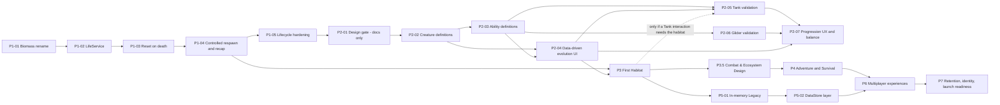

# TT-P0-02R — Implementation Migration Plan

**Status:** Proposal for review. Documentation only. **P2-01 update:** P2-01 is now defined as a documentation-only design gate; the engineering for creature definitions moved to P2-02 and the later P2 tasks were renumbered (see the P2 section). This is a proposed engineering sequence, aligned with the reviewed Evolution Adventure Sandbox Roadmap (PR #18), Combat Progression & Endgame Design (PR #19), and Product Vision & Top 1000 Strategy. It does **not** replace those product documents or authorize implementation by itself. It includes a proposed P3.5 Combat & Ecosystem Design gate before P4 combat implementation. Approving this document is **not** runtime validation of anything.
**Companion:** `Evolution Sandbox Architecture v0.1.md` (section numbers below refer to it).
**Principle:** small, reviewable steps that keep the game playable after every merge. No big-bang rewrite. Working systems are adapted, not replaced.

## What exists today versus what this plan adds

Already implemented and **not** part of this plan (verified in code at the start of P2-01; Studio validation of these steps is outstanding): arena and spawn; food collection and 0/30/60/100 Biomass progression; smooth growth; Biomass HUD; evolution selection (two-step UI, `EvolutionResult`); Tank Defensive Shell (visual only); Glider Air Glide; the Energy to Biomass rename (P1-01, PR #21); `LifeService` (P1-02, PR #22); reset on death (P1-03); controlled respawn with a minimal recap (P1-04); lifecycle hardening (P1-05, PR #26 per the owner); per-player rate limits. Forms in the prototype: `BABY_BUG`, `TANK`, `GLIDER`. The P1 steps below are kept as a record of what was planned and built.

Not implemented (everything below that is not P1 is future work): definition-driven forms and abilities; the progression redesign; habitat and discoveries; health, damage, PvE; the Striker / Hunter and Support / Controller classes; Legacy and any DataStore code; PvP and PvPvE.

**Target roster (provisional):** the Baby Bug starter (not a class) plus exactly four evolved classes: Tank / Guardian, Glider / Skirmisher, Striker / Hunter, Support / Controller. Two exist; two do not. No fifth or sixth class is in initial scope.

## How to read this plan

- Steps are numbered `P<phase>-<nn>`. Each step is intended to be one focused PR.
- **Studio** says whether Roblox Studio runtime validation is required before the step is accepted. Automated tests only cover the pure shared modules (Lune); services, UI, remotes and character lifecycle need Studio.
- "Existing files" lists what the step reads or changes; "New files" lists what it adds. Test names refer to the existing Lune convention (`tests/<Name>.test.lua`).
- The Evolution Adventure Sandbox Roadmap defines product phases P0–P7; the Combat Progression & Endgame Design document proposes an additional P3.5 design/prototype milestone. This document is a more detailed engineering sequence, not the product roadmap itself. Product Vision & Top 1000 Strategy has a separate P0–P8 strategy roadmap; do not treat those phase numbers as interchangeable with this plan's engineering steps.
- Scope inside P3 to P7 is deliberately coarser than P1 and P2 and must be refined when those phases start. P3.5 must be scoped and approved after the P0 architecture review; it is a gate before full P4 combat implementation, not permission to skip P0/P3 validation.

## Sequence changes from the brief (and why)

1. **Energy to Biomass rename is the first step of P1**, before lifecycle code, so the reset logic, tests and later Legacy schema use the final name once (architecture section 7).
2. **A damage/health step is placed in P4**, but P1 does not depend on it: lifecycle work is verified with the Roblox reset (Humanoid health set to 0). Natural death causes arrive in P4.
3. **Controlled respawn comes after the reset logic** (P1-03 before P1-04): resetting state on death is testable with default respawn; changing `CharacterAutoLoads` is the riskiest part and is isolated in its own step.
4. **P3.5 Combat & Ecosystem Design is inserted between P3 and P4**, as proposed by the combat design. It defines and prototypes the combat foundation, first PvE encounter, damage/defence/cooldown model, telegraphs, counterplay, reward economy, PvP boundaries and balance test plan before P4 scales into a polished PvE loop.
5. **Striker / Hunter and Support / Controller are gated by P3.5 and PvE validation.** Their roles and kits are not invented in this plan; they require explicit design and playtest evidence before implementation. The proposed Support / Controller role combines two candidate directions from the combat source and remains provisional.
7. **P2-01 is a documentation-only design gate** (Master Roadmap and Evolution Adventure Roadmap wording); the form-definitions engineering that an earlier draft of this plan called P2-01 is now **P2-02**, and the later P2 tasks were renumbered. Mapping: old P2-01 to P2-02, old P2-02 to P2-03, old P2-03 to P2-04, old P2-04 (availability and requirements) folded into P2-02 and P2-04, old P2-05 (visual identity hooks) deferred (see P2-05 and P2-06). Tank, Glider validation and progression balance (P2-05 to P2-07) are new tasks taken from the Master Roadmap.
6. **Persistence (P5) is split** into an in-memory Legacy model first and the DataStore layer second, so discovery gameplay can be built and tested before any DataStore code exists.

This engineering sequence follows the product roadmap's intent while retaining its exit gates; it does not make the proposed P3.5 milestone final or authorize full combat implementation before the design review.

## Dependency overview

---

## P1 — Core Life Cycle

Goal of the phase: a life can end and a new one begins from a clean `BABY_BUG` state, with no stale effects, using the existing arena.

### P1-01 — Rename Energy to Biomass (behavior-neutral)

- **Goal:** one Current Life resource named Biomass; no gameplay change. (Skip or reduce to a UI-only label if the owner chooses to keep "Energy"; decision Q1.)
- **Existing files:** `Config.lua`, `Growth.lua`, `PlayerDataService.lua`, `FoodService.lua`, `EvolutionService.lua`, `GrowthService.lua`, `EnergyUIController.lua`, all four tests, README.
- **New files:** none. `EnergyUIController` may be renamed (for example `BiomassUIController`) together with its bootstrap line.
- **Dependencies:** none.
- **Acceptance:** attribute `Biomass` replaces `Energy`; `FoodBiomass`, `EvolutionBiomassRequired` replace the Energy constants; values unchanged (cap 100, food 10, stages 0/30/60); HUD text updated; no references to the old names remain except in release notes.
- **Tests:** all existing tests pass after renaming; no new logic.
- **Studio:** yes (HUD, food, growth, evolution readiness; smoke test).

### P1-02 — `LifeService`: life state and death detection (no reset yet)

- **Goal:** one authoritative place that knows a player's life state (`Alive`, `Ended`) and `lifeId`, and announces life end and begin.
- **Existing files:** `Bootstrap.server.lua` (wire the service). Reads `Humanoid.Died` and `CharacterRemoving`.
- **New files:** `Services/LifeService.lua`; `Shared/Life.lua` (pure transition rules: valid transitions, idempotent end, `lifeId` increment); `tests/Life.test.lua`.
- **Dependencies:** P1-01 recommended.
- **Acceptance:** exactly one `LifeEnded` per life even with duplicate signals; `lifeId` increments only on a new life; a `LifeState` attribute (or server-only state) reflects `Alive/Ended`; no gameplay change yet (progress still survives).
- **Tests:** transitions, idempotency, stale-event rejection by `lifeId`.
- **Studio:** yes (reset button produces one `LifeEnded`; leave during life; respawn).

### P1-03 — Reset Current Life on death

- **Goal:** death clears Current Life: Biomass to 0, form to `BABY_BUG`, cooldowns and effects cleared, next life starts at stage 1.
- **Existing files:** `PlayerDataService.lua`, `EvolutionService.lua`, `AbilityService.lua`, `GrowthService.lua`, `EvolutionUIController.lua` (clear local selection when the form attribute changes).
- **New files:** none (each service subscribes to `LifeService` events and resets only its own state; a `ResetLife` function per service).
- **Dependencies:** P1-02.
- **Acceptance:** after death: Biomass 0, `EvolutionForm = BABY_BUG`, no ability state, scale at stage 1, evolution panel closed; delayed callbacks from the old life (timers, tweens, requests) do nothing; resetting twice is harmless; other players are unaffected.
- **Tests:** pure helpers for reset values; `lifeId` guard rules; extend `Multiplayer.test.lua` for per-player isolation of a reset.
- **Studio:** yes, essential (death during glide/shell/tween/evolution panel; two players; rapid deaths).

### P1-04 — Controlled respawn and a minimal recap

- **Goal:** the player decides when the next life starts; a minimal recap shows life duration and highest form.
- **Existing files:** `LifeService.lua`, `Bootstrap.server.lua`, `ClientBootstrap.client.lua`.
- **New files:** `Controllers/LifeRecapController.lua` (minimal screen with BEGIN NEW LIFE); `Remotes.RequestBeginNewLife`, `Remotes.LifeRecap` (created by `LifeService`); `tests/Life.test.lua` additions.
- **Dependencies:** P1-03.
- **Acceptance:** `CharacterAutoLoads = false` set by the server; first spawn still works; after death the recap shows; BEGIN NEW LIFE spawns a fresh `BABY_BUG`; spam and out-of-state requests are ignored; disconnect during recap leaves no state.
- **Tests:** pure transition and request-validity rules.
- **Studio:** yes, essential (first join, Play Solo, respawn timing, load order with `GrowthService`, mobile button, two players).

---

## P2 — Evolution System

Goal of the phase: fix the progression and evolution design first (P2-01), then make forms and abilities data, with Tank and Glider behaving exactly as before (P2-02 to P2-04), then validate and iterate (P2-05 to P2-07). **No new forms are added in P2.**

P2 adds **no new classes**. Striker / Hunter and the proposed Support / Controller hybrid remain future roles; their mechanics are not designed here. They are gated by the P3.5 combat design and the first validated PvE loop, then may be implemented as conditional P4 follow-ups (P4-05 and P4-06). The Master Roadmap's gated "additional initial roles" item is therefore **not** a P2 task.

This is a proposed engineering sequence, not an approved roadmap, and approving it is not runtime validation of anything. The design the tasks implement is in `Combat Progression & Endgame Design v0.1.md`, section 13, and the technical alignment is in `Evolution Sandbox Architecture v0.1.md`, section 6.1.

| Task | Title | Type | Status |
|---|---|---|---|
| P2-01 | Progression & Evolution Design Gate | Documentation only | Drafted, PROPOSED, awaiting owner approval |
| P2-02 | Creature Definitions (data-driven forms) | Engineering | FUTURE |
| P2-03 | Ability Definitions (data-driven abilities) | Engineering | FUTURE |
| P2-04 | Data-driven Evolution UI | Engineering | FUTURE |
| P2-05 | Tank gameplay validation and iteration | Playtest plus small changes | FUTURE |
| P2-06 | Glider gameplay validation and iteration | Playtest plus small changes | FUTURE |
| P2-07 | Progression UX and balance validation | Playtest plus approved changes | FUTURE |

### P2-01 — Progression & Evolution Design Gate

- **Goal:** fix the progression and evolution design (layers, one-life loop, Biomass versus growth versus evolution, Tank and Glider roles, activities, anti-grind and retention principles, playtest plan) before any of it is built.
- **Scope:** documentation only. Updates the Evolution Adventure Sandbox Roadmap, the Master Roadmap, the Evolution Sandbox Architecture, the Combat Progression & Endgame Design (new section 13) and this plan. No new document.
- **Dependencies:** P1-05 merged.
- **Out of scope:** any `.lua` or project configuration change, new remotes or services, DataStore, new forms or abilities, monetization products, playtests, and any P2-02 implementation.
- **Acceptance criteria:** the documents agree on P2-01 scope and the P2-02 to P2-07 sequence; current implementation (IMPLEMENTED) and proposed design (PROPOSED) are labelled apart; the decisions in the Combat doc, section 13.11, are approved, changed or rejected by the owner; no code file changed. The Master Roadmap checkboxes are ticked only after that approval.
- **Tests:** none. Verified by a consistency review of the documents.
- **Studio:** not applicable.

### P2-02 — Creature Definitions

- **Goal:** `BABY_BUG`, `TANK`, `GLIDER` described in one data module with each form's requirement and ability references; evolution validation and availability read it. Growth milestones become data with **today's values unchanged**.
- **Scope:** existing `Config.lua`, `Evolution.lua`, `EvolutionService.lua`, `EvolutionUIController.lua` (read-only use); new `Shared/CreatureDefinitions.lua` (anticipated by the v0.1 Technical Design) and `tests/CreatureDefinitions.test.lua`.
- **Dependencies:** P2-01 approved; P1-03 (life reset uses the starter form id).
- **Out of scope:** ability data (P2-03), generated UI (P2-04), changing Biomass values, the cap or the curve (P2-07), new forms, persistence.
- **Acceptance criteria:** `Evolution.Select`, `IsValidForm` and `IsAvailable` use definitions; `Config.EvolutionForms` and `BaseForm` are thin aliases or removed; availability comes from one server function and is identical to today for the two forms; `RequestEvolution` and `EvolutionResult` contracts unchanged.
- **Tests:** definitions are well-formed (unique ids, starter exists, ability ids refer to real abilities); all existing evolution tests pass; availability matrix (requirement met or not, already selected).
- **Studio:** yes (evolution flow smoke test).

### P2-03 — Ability Definitions

- **Goal:** `RequestAbility` looks up an ability definition and calls the existing handler; durations, cooldowns and glide parameters come from data.
- **Scope:** `Ability.lua`, `AbilityService.lua`, `AbilityController.lua`, `Config.lua`; optional `Shared/AbilityDefinitions.lua`.
- **Dependencies:** P2-02.
- **Out of scope:** new abilities, changing ability behavior or values, making the shell mechanical (P4-04), generated UI (P2-04).
- **Acceptance criteria:** `activateShell` and `activateGlide` unchanged as handlers; wrong-form and unknown ids are rejected as before; timestamp attributes unchanged unless Q8 says otherwise.
- **Tests:** existing `Ability` tests pass against definition-sourced values; unknown id rejected.
- **Studio:** yes (Tank shell and Glider regression, spam, cooldowns, death during effects).

### P2-04 — Data-driven Evolution UI

- **Goal:** selection cards are generated from the forms currently available; names, roles, ability text and limitations come from definitions and stay honest about what is implemented.
- **Scope:** `EvolutionUIController.lua`.
- **Dependencies:** P2-02 (and P2-03 for ability text).
- **Out of scope:** a new evolution flow, a visual redesign, new forms, final art.
- **Acceptance criteria:** same two-step flow; adding a definition adds a card without UI code changes; the layout stays within the current responsive bounds (check with 2, 3 and 4 cards).
- **Tests:** none for UI; pure ordering or label helpers if extracted.
- **Studio:** yes (layout at several sizes, selection, confirm, rejection messages).

### P2-05 — Tank gameplay validation and iteration

- **Goal:** find out whether the Tank has a validated identity. Define and prototype at least one Tank world interaction that does not need combat, or record that the Tank's role depends on P3 and P4.
- **Scope:** playtest scenarios 4 and 7 of the Combat doc (section 13.10); small parameter changes through definitions; written findings.
- **Dependencies:** P2-03, P2-04; P3-01 if an interaction needs the habitat.
- **Out of scope:** the damage and health system (P4-01), making the shell mechanical (P4-04), any new form, any combat.
- **Acceptance criteria:** observed results are recorded separately from targets; the Tank's identity statement is either validated or its dependency recorded; decisions are logged for the owner.
- **Tests:** pure tests for any rule that changes.
- **Studio:** yes.

### P2-06 — Glider gameplay validation and iteration

- **Goal:** validate the glide and its arena use: reachability of the glider-only platforms for Baby Bug versus Glider (currently an analytic estimate), glide feel and landing, and that the Glider is not a universally best mobility option.
- **Scope:** playtest scenarios 5 and 10 of the Combat doc; small parameter changes through definitions; written findings.
- **Dependencies:** P2-03.
- **Out of scope:** flight or hovering, new traversal systems, habitat production (P3), new forms.
- **Acceptance criteria:** Studio reachability results are recorded; the 0.65 gravity compensation and its effect on jump apex are confirmed or changed through data; findings are logged.
- **Tests:** pure tests for any rule that changes.
- **Studio:** yes.

### P2-07 — Progression UX and balance validation

- **Goal:** measure pacing and, only after owner approval of D-P2-6, implement the approved Biomass model (keep accumulating after evolution, a per-life ceiling at the final growth milestone, a longer milestone curve), plus milestone feedback, a visible next goal and cross-form balance.
- **Scope:** `Config.lua` or the definitions, `PlayerDataService.lua`, `FoodService.lua`, `GrowthService.lua`, HUD controllers; tests; the measurements in Combat doc section 13.5.
- **Dependencies:** P2-02 to P2-06; owner approval of the progression decisions.
- **Out of scope:** spending Biomass, a second resource, new forms, Legacy persistence, a telemetry system (P7), combat.
- **Acceptance criteria:** pacing metrics are measured and recorded, not invented; values live in data; unit tests cover the curve and the ceiling; a first-player usability test result is recorded; the P2 exit gate in the Master Roadmap is evaluated honestly.
- **Tests:** pure tests for the curve, ceiling and eligibility.
- **Studio:** yes (first-player test, multiplayer, regression of abilities and lifecycle).

---

## P3 — First Habitat

Goal: turn the greybox arena into the first habitat with things to find, without persistence yet. Scope below is coarse and must be refined.

### P3-01 — Zones and landmarks as tagged data

- **Goal:** habitat divided into named zones; landmarks marked with CollectionService tags (for example `Zone`, `Landmark`) following the existing `FoodSpawn` pattern.
- **Existing files:** `Workspace/Arena/*`, `README.md`.
- **New files:** additional model files or tags under `Workspace`; `Shared/HabitatDefinitions.lua`.
- **Dependencies:** P1-04.
- **Acceptance:** zones and landmarks exist in the built place; traversal routes (jump, glide) still make sense for Baby Bug, Tank, Glider.
- **Tests:** definitions well-formed.
- **Studio:** yes (route and reachability checks; the P0 reachability test for glider platforms).

### P3-02 — `DiscoveryService` (session-only)

- **Goal:** server-validated discoveries (entering a zone, finding a landmark or secret), recorded in memory per life/session, private to the owner.
- **Existing files:** `Bootstrap.server.lua`.
- **New files:** `Services/DiscoveryService.lua`; `Shared/Discovery.lua` (pure rules: first-discovery, idempotency); tests.
- **Dependencies:** P3-01, P1-02.
- **Acceptance:** discovery recorded once; position validated on the server; no client remote can claim a discovery; a discovery never grants teleport or power.
- **Tests:** pure first-discovery/idempotency rules.
- **Studio:** yes.

### P3-03 — Species and food variety (minimal)

- **Goal:** a few distinct food or creature species to discover, feeding the future bestiary; existing food system extended, not replaced.
- **Existing files:** `FoodService.lua`, `Food.lua`, `Config.lua`.
- **New files:** species definitions.
- **Dependencies:** P3-02.
- **Acceptance:** species are data; collection rules (single winner, once) unchanged; balance of the 0/30/60/100 progression is reviewed, not silently changed.
- **Tests:** extend `Food`/`Multiplayer` tests.
- **Studio:** yes.

---

## P3.5 — Combat & Ecosystem Design (proposed gate)

This is the proposed milestone from Combat Progression & Endgame Design. It must be formalized after the P0 architecture review and completed before P4 expands into production combat. It is a **design and limited-prototype milestone**, not a full combat rollout.

### P3.5-01 — Combat rules and first PvE encounter design

- **Goal:** define a compact, readable combat loop and one or two first NPC encounter concepts that fit the first habitat and current forms.
- **Dependencies:** P0 architecture review and P3 habitat direction; do not start full implementation before these are accepted.
- **Deliverables:** attack/defence action set; wind-up, active and recovery windows; hit/damage authority rules; interruption and stagger limits; cooldown/resource model; telegraphs and counterplay; accessibility/input requirements; first PvE encounter specification.
- **Acceptance:** players can understand why an action hits, misses, is blocked or interrupted; no unavoidable chain-stuns or invisible damage; server authority and exploit boundaries are documented; scope is small enough for a first vertical slice.
- **Tests / Studio:** tabletop/design review plus a limited Studio prototype where appropriate; record what was actually tested. No production combat system is implied by this design step.

### P3.5-02 — Rewards, defeat, PvP boundaries and balance plan

- **Goal:** define reward integrity and the boundaries that keep PvE enjoyable and multiplayer fair.
- **Dependencies:** P3.5-01.
- **Deliverables:** risk- and contribution-aware PvE rewards; defeat/death interaction; anti-farming rules; optional PvP boundaries; PvPvE questions to explore only if justified; initial balance/playtest/telemetry plan.
- **Acceptance:** PvE progression does not require PvP; PvP remains optional; ordinary player kills do not create large Biomass rewards; new players are protected from repeated farming; no monetized combat advantage; balance hypotheses have observable tests.
- **Tests / Studio:** review with representative playtest scenarios; validate the first prototype and record unresolved questions before P4 approval.

**P3.5 exit gate:** approve the combat rules, one small PvE encounter prototype, server-authority contract, reward/anti-farming rules and balance test plan. If the prototype is not readable or fun, revise it before P4; do not compensate by adding more classes or complexity.

---

## P4 — Adventure and Survival

Goal: reasons to take risk, and real death causes. Scope is coarse.

### P4-01 — Health and damage foundation

- **Goal:** a server-owned health/damage model so lives can end naturally and abilities can mean something.
- **Existing files:** `AbilityService.lua`, `PlayerDataService.lua`, HUD.
- **New files:** damage service and pure rules; tests.
- **Dependencies:** P1-03, approved P3.5 combat rules/prototype.
- **Acceptance:** damage applied only by the server; death goes through `LifeService`; no client-reported damage; implementation matches the P3.5 authority and telegraph contract.
- **Tests:** pure damage rules.
- **Studio:** yes.

### P4-02 — First hazards and a simple threat

- **Goal:** environment hazards and/or a simple predator to create risk in the habitat.
- **Dependencies:** P4-01, P3-01. **Acceptance and tests:** defined when the phase starts; must not require client authority. **Studio:** yes.

### P4-03 — Temporary objectives and upgrades

- **Goal:** Current Life objectives and temporary upgrades, reset on death.
- **Dependencies:** P1-03. **Acceptance:** all state reset on life end; none persists. **Tests:** pure rules. **Studio:** yes.

### P4-04 — Make the Tank shell mechanical (if approved by the combat design)

- **Goal:** replace "visual only" with a real defensive effect once damage exists.
- **Dependencies:** P4-01. **Acceptance:** documented, balanced, server-side only. **Tests:** pure rules. **Studio:** yes.

### P4-05 — Striker / Hunter class (provisional role; design first)

- **Goal:** design and add the third evolved class. Its abilities, numbers and final name are **not defined by this plan**; they come from the class design.
- **Existing files:** `CreatureDefinitions.lua` (P2-02), `AbilityService.lua` handlers (P2-03), `EvolutionUIController.lua` (data-driven cards, P2-04).
- **New files:** a form definition, ability definition and handler.
- **Dependencies:** P3.5 exit gate, P4-01, P4-02, P2-03, P2-04. Do not begin class implementation until the first PvE loop has been playtested and the role has a validated use case.
- **Acceptance:** distinct strengths, weaknesses, counterplay and gameplay identity written down before coding; the class adds a meaningful interaction not already served by Tank/Glider; selectable only through the existing validated flow; server-authoritative; no permanent power; wrong-form requests rejected. This is a conditional follow-up, not a prerequisite for the first PvE vertical slice.
- **Tests:** pure rules for its ability; form/ability definition validation.
- **Studio:** yes.

### P4-06 — Support / Controller class (provisional role; design first)

- **Goal:** design and add the fourth evolved class, completing the initial roster. Same rules and unknowns as P4-05.
- **Dependencies:** P3.5 exit gate, P4-01, P4-02, P4-05, P2-03, P2-04; any multiplayer-interaction needs from P6 must be identified by the design first.
- **Acceptance and tests:** as P4-05. The proposed Support / Controller hybrid must be validated against the separate Support / Warden and Controller / Disruptor candidate directions in the combat design. Adding it must need no UI code changes. The initial roster remains four; a fifth or sixth form is out of scope until real player feedback and gameplay validation.
- **Studio:** yes.

---

## P5 — Legacy and Persistence

### P5-01 — In-memory Legacy model

- **Goal:** `LegacyService` holds discoveries, unlocks, history and stats in memory, with mergeable (set/union, per-`lifeId`) rules and schema version 1; the Life Recap uses it.
- **Existing files:** `LifeService.lua`, `DiscoveryService.lua`, `LifeRecapController.lua`.
- **New files:** `Services/LegacyService.lua`, `Shared/Legacy.lua` (pure merge and migration functions), tests.
- **Dependencies:** P3-02, P1-04.
- **Acceptance:** discoveries survive death within a session; no power values exist in the schema; unlocks are consumed only through the "available forms" function from P2-02.
- **Tests:** merge, idempotency, migration, "no power fields" schema check.
- **Studio:** yes.

### P5-02 — `PersistenceService` (DataStore)

- **Goal:** load and save Legacy safely (architecture section 8).
- **Existing files:** `LegacyService.lua`, `Bootstrap.server.lua`.
- **New files:** `Services/PersistenceService.lua`.
- **Dependencies:** P5-01.
- **Acceptance:** bounded load retries; single in-flight save per player; `UpdateAsync` merge; success only on confirmed return; saves on discovery, life end, autosave, `PlayerRemoving`, `BindToClose`; "unavailable" mode with in-memory fallback and later merge; never overwrites stored data after a failed load.
- **Tests:** pure merge/migration (already P5-01); retry/backoff schedule helper; DataStore calls behind a thin interface so failure paths can be exercised with a fake.
- **Studio:** yes, with Studio API access enabled and disabled; two-session overlap; shutdown.

### P5-03 — Permanent unlocks widen evolution options

- **Goal:** Legacy unlocks feed `available forms` (P2-02); first unlockable form content is a separate decision.
- **Acceptance:** discovered, available and selected remain distinct; no automatic power. **Tests:** availability matrix with unlocks. **Studio:** yes.

### P5-04 — History, achievements, collections, cosmetics hooks

- **Goal:** bounded life history and a minimal achievements/collections list; cosmetic identity options only (no stat effects).
- **Dependencies:** P5-01. **Acceptance:** bounded size; no power. **Tests:** pure rules. **Studio:** yes.

### P5-05 — Failure UX and data migration drills

- **Goal:** visible "Legacy unavailable" state, retry behavior, and a tested migration from schema v1 to v2 using a fixture.
- **Dependencies:** P5-02. **Tests:** migration fixtures. **Studio:** yes.

---

## P6 — Multiplayer experiences

Scope is coarse; refine at phase start.

### P6-01 — Concurrency and lifecycle hardening for the new model

- **Goal:** many players dying, respawning, discovering and saving at once; extend the multiplayer test matrix to lives.
- **Dependencies:** P1 to P5. **Tests:** extend `Multiplayer.test.lua`. **Studio:** yes (3+ clients).

### P6-02 — Privacy and replication budget

- **Goal:** decide what other players may see (Q9); move private data off Player attributes onto owner-only remotes; review replication volume.
- **Dependencies:** P5-01. **Acceptance:** no private data visible to other clients. **Studio:** yes.

### P6-03 — Cooperative activities and helping-friends loop

- **Goal:** add co-op contracts, group encounters/events and useful ways for experienced players to help newer friends, without making solo play feel excluded or helpless.
- **Dependencies:** validated PvE loop (P4), P6-01 and the relevant Legacy/progression rules.
- **Acceptance:** contribution and rewards are readable; party scaling avoids trivial carry/farming; solo play remains viable; no permanent raw-power gap is created. **Tests and Studio:** yes, with 3+ clients.

### P6-04 — Optional PvP and exploratory PvPvE

- **Goal:** only after the PvE core (P4) and cooperative foundations are validated, test clearly optional, fair PvP formats. Explore PvPvE only if a specific world interaction justifies it; neither mode is required for progression.
- **Dependencies:** P3.5 PvP boundaries, P4, P6-01 and P6-03.
- **Acceptance:** safe onboarding, opt-in boundaries, anti-griefing and anti-farming rules; server-authoritative damage and rewards; no paid or permanent combat advantages. **Tests and Studio:** yes, with 3+ clients.

---

## P7 — Retention, identity, polish and launch readiness

Scope is coarse; each item becomes its own plan when reached.

- **P7-01 Creature identity:** final models, animation, audio, VFX for forms (replaces any P2 placeholder identity). **Studio:** yes.
- **P7-02 Onboarding:** first-minute flow, controls teaching, mobile layout pass. **Studio:** yes.
- **P7-03 Performance and stability:** server/client budgets, remote and attribute volume, memory (connection/instance leaks), low-end device checks. **Studio:** yes.
- **P7-04 Retention, telemetry and QA matrix:** repeatable challenges/endgame hooks, what to measure, and full multiplayer, mobile and persistence QA pass.
- **P7-05 Launch readiness:** accessibility, store page, policy review, moderation considerations. Monetization is outside this plan; whatever is decided later must not include paid resurrection, death protection or combat advantages.

---

## Definition of done for every step

- Scope limited to the step; no unrelated refactoring.
- Server remains authoritative; no client-supplied gameplay values.
- Pure logic covered by Lune tests; Roblox-dependent behavior covered by a written manual Studio checklist, with an honest record of what was and was not run.
- README updated for any behavior change.
- Rojo build run; results reported honestly.
